# CamCtrl Cardputer

**A handheld remote for Blackmagic cameras, on the M5Stack Cardputer ADV.**

Plug the Cardputer into the camera's USB‑C port and hold it in your hand: one‑press autofocus,
and focus, iris, shutter, ISO, white balance (with tint) and clean feed on its own screen and
keyboard. No phone,
no cables to a computer, no setup on the camera beyond DHCP. It runs from the camera's port.

<p align="center">
  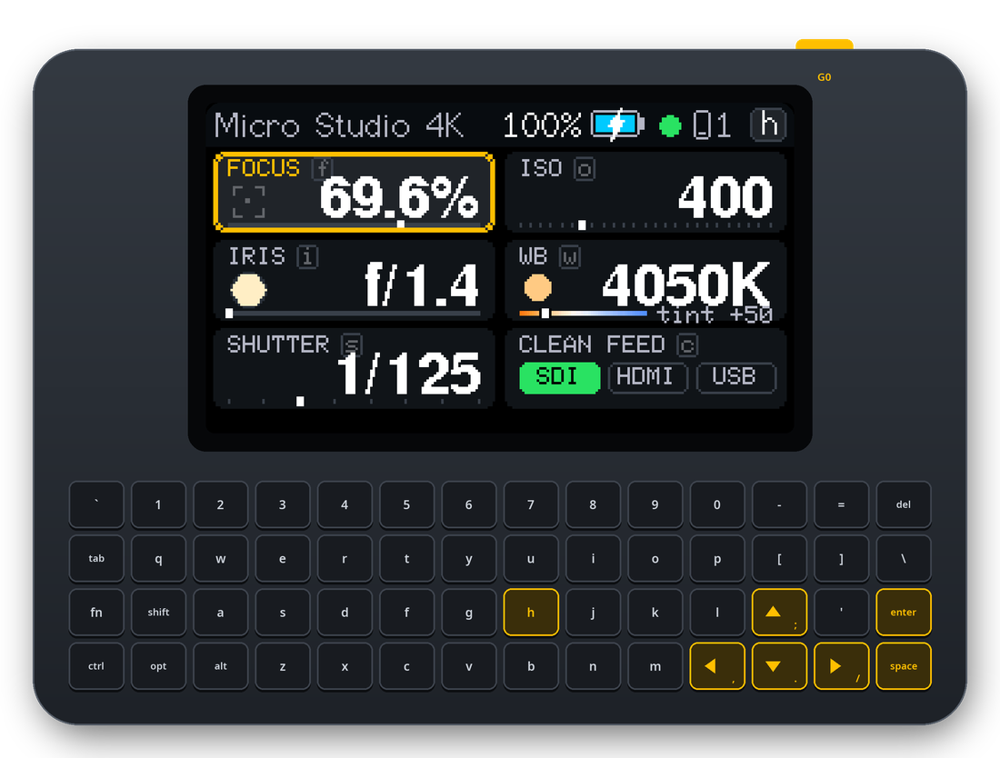
</p>

| Focus | Iris | Shutter |
|---|---|---|
| 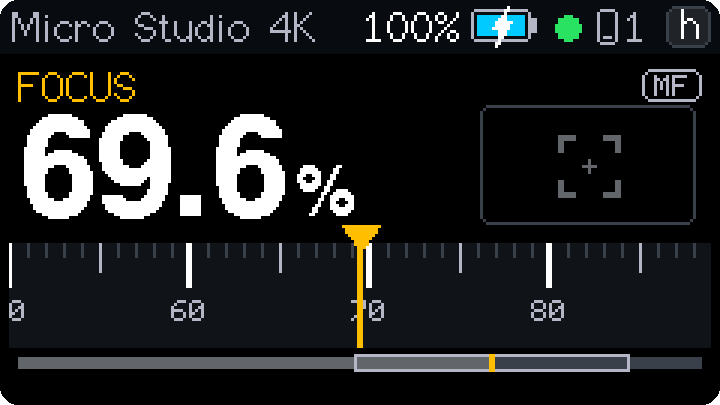 | 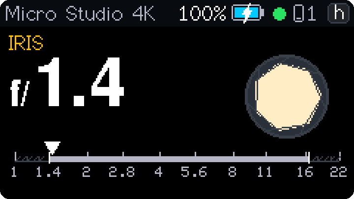 | 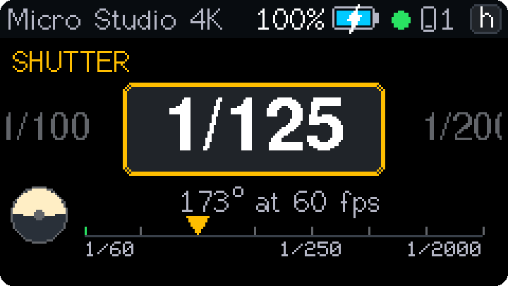 |
| **ISO** | **White balance** | **Clean feed** |
| 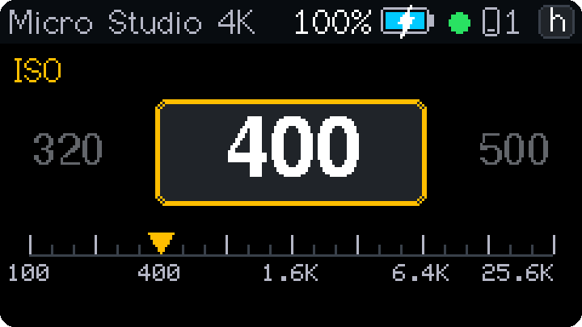 | 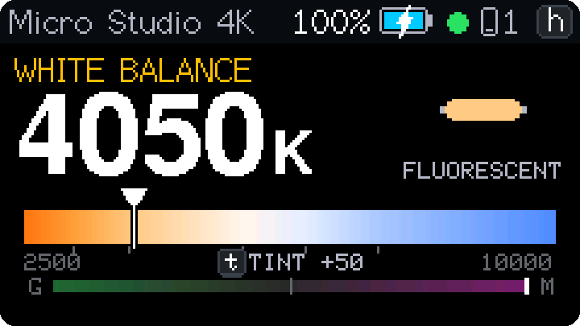 | 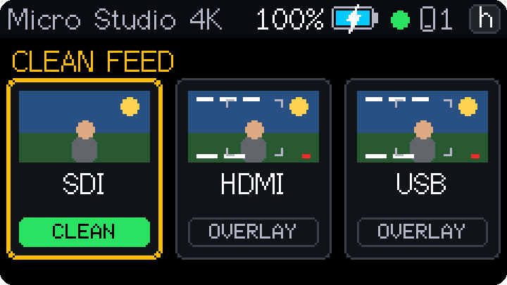 |

All screenshots are taken from the device with a real camera attached (`tools/screenshots.py`).

## Full control from your phone: CamCtrl

<a href="https://camctrl.app/">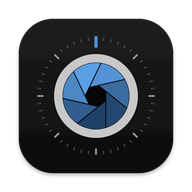</a>

**[CamCtrl](https://camctrl.app/)**, the full remote app for Blackmagic cameras<br>
<a href="https://camctrl.app/"></a>
<a href="https://camctrl.app/"></a>
<a href="https://camctrl.app/"></a>
<br clear="left">

The Cardputer is also a Wi‑Fi bridge to the camera (it is a full
**[EthAir](https://github.com/koorchik/ethair)** adapter). Join its Wi‑Fi with a phone or tablet and
**[CamCtrl](https://camctrl.app/)**, the full remote app for Blackmagic cameras, controls
everything else: focus and iris with touch, exposure, colour wheels, audio, media, recording and
monitoring overlays. The pocket remote and the app work **at the same time** and see each other's
changes live.

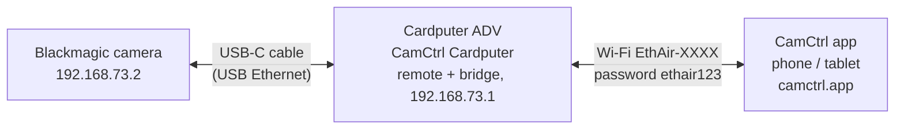

1. Plug the Cardputer into the camera (below).
2. On the phone, join the Wi‑Fi **`EthAir-XXXX`** (password **`ethair123`**; both are shown under
   `h` → `h` on the Cardputer).
3. Open CamCtrl: it finds the camera by itself, or enter **`192.168.73.2`**.

Any other app or browser that speaks the camera's REST API works the same way.

## Install

### In the browser (easiest)

Open **[koorchik.github.io/camctrl-cardputer](https://koorchik.github.io/camctrl-cardputer/)** in
Chrome or Edge on a computer and follow the steps there.

### With esptool

Download `camctrl-cardputer-cardputer-vX.Y.Z-full.bin` from the
[latest release](https://github.com/koorchik/camctrl-cardputer/releases/latest). Put the Cardputer
into download mode (power switch off, hold **G0**, switch on, release), then:

```bash
esptool.py --chip esp32s3 write_flash 0x0 camctrl-cardputer-cardputer-v1.0.0-full.bin
```

Switch it off and on again afterwards.

### M5Burner

Search for **CamCtrl** in M5Burner's Cardputer section (once it is published there).

> Cardputer **ADV** only: the remote needs the ADV's keyboard controller (TCA8418).

## Use

1. On the camera: network settings → **DHCP**.
2. **Set the Cardputer's own power switch OFF**, then plug it into the camera's USB‑C port. It runs
   from the camera. (With the battery on, the Cardputer puts 5 V on the port and the camera never
   starts its USB host.)
3. The screen walks through USB → network → camera. The first time, two cards show the keys:

| | |
|---|---|
| 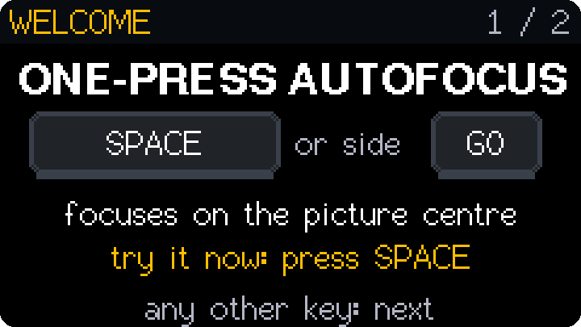 | 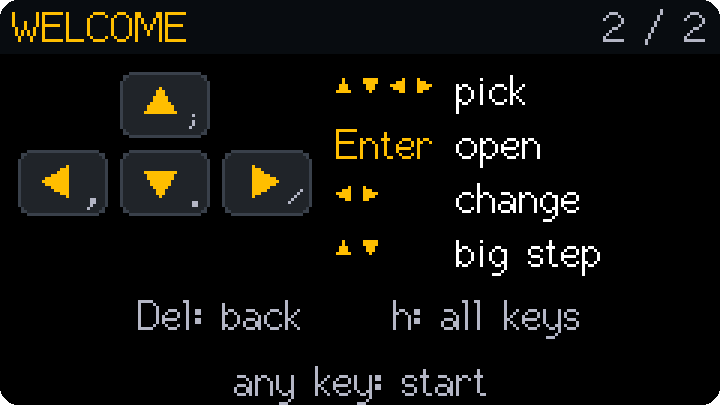 |

### Keys

| Key | |
|---|---|
| `;` `.` `,` `/` (printed ↑ ↓ ← →) | move over the two columns of controls |
| **Enter** | open the selected control |
| ← → | change it (hold = fast) |
| ↑ ↓ | big step: focus ×10, iris ×3, shutter and ISO 3 steps, WB 500 K, tint ×10 (Shift + ← → too) |
| **Enter** (control open) | focus: autofocus · WB: auto white balance · clean feed: toggle the output |
| **Space** or side button **G0** | **autofocus** |
| `f` `i` `s` `o` `w` `c` | jump to focus, iris, shutter, ISO, white balance, clean feed |
| `t` | tint (it belongs to white balance and has no tile of its own) |
| **Del** / `` ` `` | back to all controls (also by itself after 3 s) |
| `h` | all keys; `h` again: Wi‑Fi name, password, settings address |
| G0 held 5 s | factory reset (release to cancel) |

<p align="center">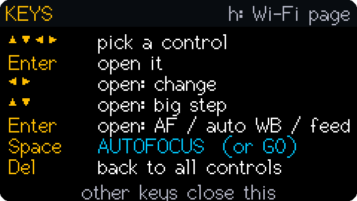</p>

### Reading the screen

- **Top bar:** camera name, `REC` / `PGM` / `PVW`, the camera's battery (a bolt while charging,
  `AC` without a battery), a green dot for the live link (amber blinking: polling), phones on
  Wi‑Fi.
- **Amber** values are sent but not yet confirmed by the camera; **white** is what the camera
  reports; a **blue flash** means someone changed it elsewhere (e.g. a phone app).
- A **red frame** around the screen: the camera is recording or on program.
- **Shutter** shows a speed (`1/125`) or an angle (`180°`), whichever the camera is set to, with
  the other unit below at the current frame rate. Green marks are flicker‑free values.
- **Tint** sits on the white‑balance tile and screen; `t` opens it.

## Troubleshooting

| What you see | What to do |
|---|---|
| `No USB data from camera` | Cardputer power switch **OFF**; a USB‑C **data** cable; push the plug in firmly or flip it. |
| `WAITING FOR CAMERA` | Set the camera's network to DHCP. |
| `LENS NOT CONTROLLABLE` | The lens has no electronic focus/iris. |
| `… SET BY AUTO EXPOSURE` | The camera's auto exposure owns the iris or shutter; switch it off on the camera. |
| Phone app cannot see the camera | Join `EthAir-XXXX` (password `ethair123`, also under `h` → `h`); Android 17+: allow *Nearby devices* for the app. |

## Updating

From a computer or phone on the Cardputer's Wi‑Fi (or USB):

```bash
curl -H "X-EthAir: 1" --data-binary @camctrl-cardputer-cardputer-v1.0.0-ota.bin http://192.168.73.1/api/ota
```

The board keeps a new image only after it has run 30 s and served a request; otherwise it rolls
back by itself. The installed version is under `h` → `h` and on `http://192.168.73.1`.

## Building

ESP‑IDF 6.1 through PlatformIO; M5GFX as an ESP‑IDF component; own TCA8418 keyboard driver.

```bash
pio test -e native             # pure logic: keys, navigation, camera JSON, DHCP, bridge…
pio run -e cardputer
tools/flash.sh                 # OTA when 192.168.73.1 answers, else USB serial
tools/release.sh               # release images into dist/
tools/screenshots.py --adb     # README screenshots from the device (through a phone with adb)
tools/publish-flasher.sh       # browser installer to GitHub Pages
```

Extra endpoints for automation: `GET /api/screen` (the screen as 240 × 135 RGB565) and
`POST /api/key?k=up|down|left|right|enter|space|back|h|f|i|s|o|w|t|c`, both with the header
`X-EthAir: 1`. Everything else (OTA with rollback, safe mode, settings page, API) is as in
[EthAir](https://github.com/koorchik/ethair#under-the-hood).

Design documents: `docs/superpowers/specs/2026-11-10-camctrl-cardputer-design.md` (goals,
protocol) and `docs/superpowers/specs/2026-11-10-remote-ui-design.md` (every screen).

## Limits

- Cardputer ADV only. Tested with a Blackmagic Micro Studio Camera 4K G2 (camera firmware 9.6.2);
  other Blackmagic cameras with the REST control API should work but are untested.
- One camera per Cardputer. Up to 4 Wi‑Fi clients at a time.

## License

MIT, see [LICENSE](LICENSE). Third‑party parts keep their own licenses: M5GFX (MIT; its bundled
fonts carry their own licenses), ESP‑IDF, esp_tinyusb and esp_websocket_client (Apache 2.0), cJSON
(MIT, test copy in `test/support/`). ESP Web Tools (Apache 2.0) is served by the installer page.

CamCtrl Cardputer is not affiliated with Blackmagic Design or M5Stack.
